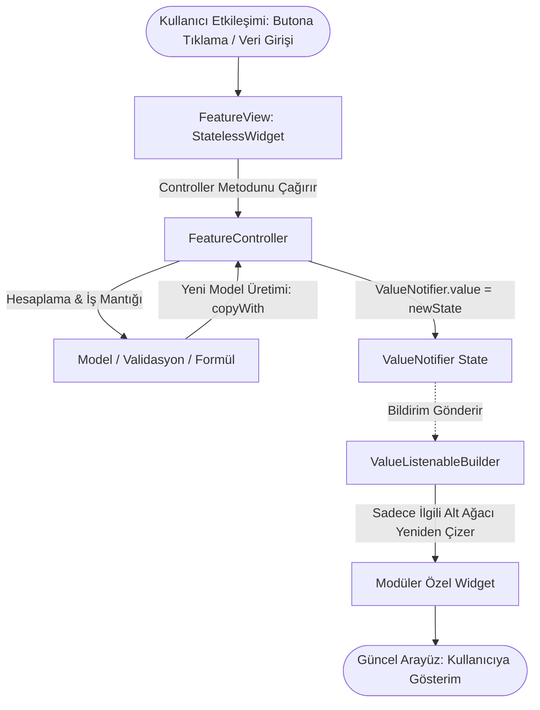

# Susadım Uygulaması - Reaktif State Yönetimi ve Akış Mimarisi (State Flow)

Bu doküman, **susadım** (akıllı su, egzersiz ve kalori takibi) projesinde kullanılan reaktif durum (state) yönetimi akışını, mimari standartları ve kırmızı çizgileri detaylandırmaktadır. Projede geliştirme yapacak tüm ajanlar ve geliştiriciler buradaki akış kurallarına uymakla yükümlüdür.

---

## 1. Mimari İlkeler ve Kırmızı Çizgiler

1. **Ağır State Paketleri Kesinlikle Yasaktır:**
   - Projede `Provider`, `Riverpod`, `Bloc`, `GetX`, `MobX` vb. harici state yönetim paketleri kullanılmaz.
   - Flutter'ın yerel çekirdek API'si olan **`ValueNotifier<T>`** ve **`ValueListenableBuilder<T>`** kullanılır.
   
2. **Sayfa Düzeyinde `setState` Yasağı:**
   - Sayfa düzeyinde veya iş mantığı (business logic) içeren kısımlarda `setState` kullanılmaz.
   - `setState` yalnızca ve sadece mikro-arayüz animasyonları, klavye açılıp kapanma durumu veya lokal UI bileşen geçişleri gibi saf görsel durumlar için kullanılabilir.

3. **Const Zorunluluğu ve Build Metodu Kuralı:**
   - Statik tüm widget'larda `const` kurucular zorunludur.
   - Hiçbir `build` metodu **40 satırı geçemez**. 40 satırı aşan her görsel parça `widgets/` klasörüne bağımsız, modüler ve `const` kuruculu özel widget olarak çıkarılmalıdır.
   - Sabit renk veya metin stilleri hardcoded girilemez; `Theme.of(context)` ve `AppColors` kullanılmalıdır.

4. **Sıfır Hata ve Uyarı İlkesi:**
   - Kod değişikliklerinden sonra `flutter analyze` çalıştırıldığında 0 hata (error) ve 0 uyarı (warning) elde edilmelidir.

---

## 2. Katmanlar ve Sorumluluk Dağılımı (Feature-Based Architecture)

Her modül (`features/<feature_name>/`) dört temel bileşenden oluşur:

```text
lib/features/<feature_name>/
├── controllers/
│   └── <feature_name>_controller.dart  # Mantık, reaktif ValueNotifier durumları, metotlar
├── models/
│   └── <feature_name>_model.dart       # Değişmez (immutable) veri modeli, copyWith, JSON
├── view/
│   └── <feature_name>_view.dart        # StatelessWidget arayüz, ValueListenableBuilder
└── widgets/
    └── <feature_name>_card.dart        # Yeniden kullanılabilir, <=40 satır alt bileşenler
```

### Katman Rolleri:
- **Model:** `@immutable` sınıf. State'i temsil eden tüm alanlar `final` tanımlanır. Değişiklikler her zaman `copyWith` ile yeni bir nesne üreterek yapılır.
- **Controller:** İş mantığını yönetir. UI'a bağımlı değildir (BuildContext içermez). State değişikliklerini `ValueNotifier` değerini güncelleyerek tetikler. `dispose()` metodu ile dinleyicileri serbest bırakır.
- **View:** `StatelessWidget` yapısındadır. Controller'daki `ValueNotifier` nesnelerini `ValueListenableBuilder` ile dinler. Sadece değişen alt widget ağacını yeniden çizer.
- **Widgets:** Saf gösterim bileşenleridir. İhtiyaç duydukları veriyi parametre olarak alır; iş mantığı barındırmaz.

---

## 3. Durum Akış Şeması (Mermaid)

Aşağıdaki şema, kullanıcı etkileşiminden ekranın yeniden çizilmesine kadar olan reaktif döngüyü özetler:



---

## 4. Egzersiz Takibi ve Dinamik Su İhtiyacı Akışı

**susadım** uygulamasının temel işlevi, egzersiz yaptıkça anlık su ihtiyacını hesaplayıp günlük hedefe entegre etmektir:

1. **Egzersiz Verisi Girişi:**
   - Kullanıcı egzersiz türünü (koşu, ağırlık, kardiyo vb.) ve süresini (dakika) girer.
2. **Controller Hesaplaması:**
   - Egzersiz yoğunluk katsayısı (MET) ve süre baz alınarak terleme kaybı hesaplanır:
   $$\text{Ek Su (ml)} = \text{Süre (dk)} \times \text{Yoğunluk Katsayısı (ml/dk)}$$
   - Örneğin 45 dakikalık kardiyo egzersizi için: $45 \times 12 = 540\text{ ml}$ ek su ihtiyacı oluşur.
3. **Reaktif Bildirim:**
   - `WorkoutController`, `WaterTrackerController`'a hesaplanan ek su miktarını iletir.
   - `WaterTrackerController.addRequiredWater(540)` metodu `dailyGoalWater` değerini reaktif olarak günceller.
   - `ValueListenableBuilder` anında hedef grafiğini günceller ve kullanıcıya dinamik uyarı kartı gösterir.

---

## 5. Çift Tema Yönetimi Akışı (Theme State Flow)

Proje, harici paket kullanmadan çift tema desteği sunar:

- **Koyu Tema (Dark Mode):** Gece spor salonu paleti (*Dark Obsidian & Neon Cyan / Blue*).
- **Aydınlık Tema (Light Mode):** Canlı sporcu paleti (*Clean White, Sky Blue & Dynamic Slate*).

### Tema Akışı:
1. `ThemeController` çekirdekte (`lib/core/theme/theme_controller.dart`) tekil (singleton/static) bir `ValueNotifier<ThemeMode>` barındırır.
2. `main.dart` içindeki `MaterialApp` kökü, bu `themeNotifier`'ı bir `ValueListenableBuilder` ile dinler:
   ```dart
   ValueListenableBuilder<ThemeMode>(
     valueListenable: ThemeController.themeModeNotifier,
     builder: (context, themeMode, _) {
       return MaterialApp(
         theme: AppTheme.lightTheme,
         darkTheme: AppTheme.darkTheme,
         themeMode: themeMode,
         home: const WaterTrackerView(),
       );
     },
   );
   ```
3. Kullanıcı arayüzdeki tema değiştirme butonuna tıkladığında `ThemeController.toggleTheme()` çağrılır ve tüm uygulama yeniden başlamadan anında renk değiştirir.

---

## 6. Bellek Yönetimi ve Yaşam Döngüsü (Lifecycle & Disposal)

Reaktif akışta bellek sızıntılarını (memory leaks) engellemek için şu kurallara riayet edilir:

- Controller bir `StatefulWidget` içinde yerel olarak barındırılıyorsa, `State.dispose()` anında mutlaka `controller.dispose()` çağrılmalıdır.
- Singleton veya servis olarak kayıtlıysa, oturum veya sayfa sonlandığında `dispose()` veya `reset()` işletilmelidir.
- `ValueNotifier` üzerindeki `addListener` bağlantıları, dinleyen bileşen yok edildiğinde `removeListener` ile kaldırılmalıdır.

---

## 7. Test Stratejisi (0 Hata & 0 Uyarı)

State mimarisi doğrudan test edilebilir olarak tasarlanmıştır:

1. **Birim Testleri (`flutter test`):**
   - Controller mantığı saf Dart nesnesi olduğundan `BuildContext` veya mock widget ağacı gerektirmeden doğrudan test edilir:
   ```dart
   test('addWater eklenen miktarı reaktif olarak güncellemelidir', () {
     final controller = WaterTrackerController();
     expect(controller.currentWater.value, 0);
     controller.addWater(250);
     expect(controller.currentWater.value, 250);
     controller.dispose();
   });
   ```
2. **Widget Testleri:**
   - `pumpWidget` ile `ValueListenableBuilder` tetiklenmesi ve arayüzün doğru metin/bileşenleri çizdiği doğrulanır.
