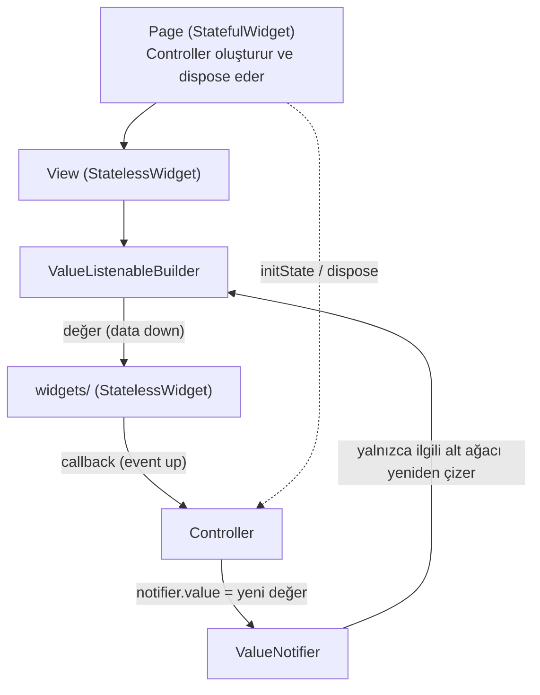
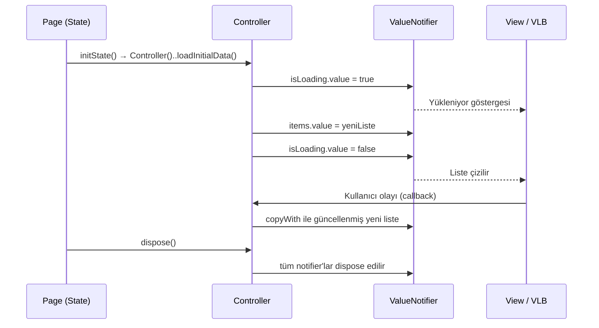
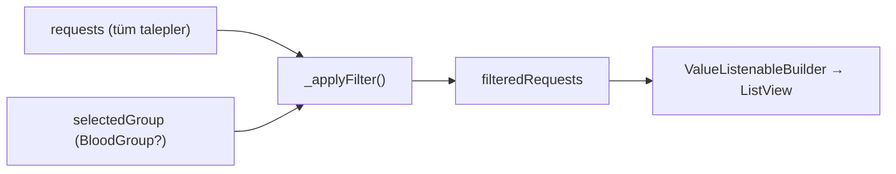

# CanBağım State Akışı Referansı (ValueNotifier Standardı)

Bu doküman, `SKILL.md` içindeki **State Yönetimi Standartı** ve `project.md` içindeki **4. Kırmızı Çizgiler** bölümünün uygulamalı referansıdır. Tüm modüller (`blood_values`, `donation_centers`, `urgent_requests`, `donation_statistics`) burada anlatılan veri akışına uymak zorundadır.

---

## 1. Temel İlke: Veri Aşağı, Olay Yukarı



| Katman | Sorumluluk | Yasak |
|---|---|---|
| `models/` | Immutable veri, `copyWith`, `fromJson`, `toJson`, tıbbi durum hesapları | Flutter UI importu (`material.dart`), mutable alan |
| `controllers/` | `ValueNotifier` sahipliği, iş mantığı, filtreleme, `dispose()` | `BuildContext` tutmak, widget döndürmek |
| `views/` | Controller'ı `ValueListenableBuilder` ile UI'a bağlamak | İş mantığı, 40 satırı aşan `build` |
| `widgets/` | Saf görsel bileşenler; veriyi parametre, olayı callback ile alır | `ValueNotifier` dinlemek, controller'a doğrudan erişmek |

---

## 2. Yaşam Döngüsü (Lifecycle)

1. **Oluşturma:** Controller yalnızca sayfa sahibi olan `StatefulWidget` içindeki `initState` metodunda bir kez oluşturulur.
2. **Yükleme:** `initState` içinde `..loadInitialData()` çağrılır.
3. **Dinleme:** View, `ValueListenableBuilder` ile yalnızca ihtiyaç duyduğu notifier'ı dinler.
4. **Güncelleme:** Controller her zaman **yeni bir liste/nesne** atar (`notifier.value = [...]`). Mevcut listeyi yerinde değiştirmek (`value.add(...)`) dinleyicileri tetiklemez.
5. **Temizlik:** `dispose` metodunda `controller.dispose()` çağrılır; controller tüm notifier'larını ve listener'larını kapatır.



---

## 3. Standart Durum Seti

Her controller en az şu üç durumu taşır. Ek durumlar (filtre, seçim) aynı kalıpla eklenir.

| Notifier | Tip | Amaç |
|---|---|---|
| `isLoading` | `ValueNotifier<bool>` | Yükleme göstergesi |
| `errorMessage` | `ValueNotifier<String?>` | `null` ise hata yok; değilse kullanıcıya gösterilecek Türkçe mesaj |
| `items` / modüle özel ad | `ValueNotifier<List<T>>` | Ekranda gösterilen veri |

**View içinde kontrol sırası:** `isLoading` → `errorMessage` → boş liste → dolu liste.

---

## 4. Asenkron Güvenlik (`_isDisposed` Koruması)

Kullanıcı veri yüklenirken sayfadan çıkarsa, dispose edilmiş bir `ValueNotifier`'a değer atamak `FlutterError` fırlatır. Bu yüzden her `await` sonrasında kontrol zorunludur:

```dart
bool _isDisposed = false;

Future<void> loadInitialData() async {
  if (_isDisposed) return;
  isLoading.value = true;
  errorMessage.value = null;
  try {
    final result = await _fetch();
    if (_isDisposed) return;
    requests.value = result;
  } catch (_) {
    if (_isDisposed) return;
    errorMessage.value = 'Veriler yüklenemedi. Lütfen tekrar deneyin.';
  } finally {
    if (!_isDisposed) isLoading.value = false;
  }
}

void dispose() {
  _isDisposed = true;
  // notifier'lar burada dispose edilir
}
```

---

## 5. Türetilmiş Durum (Filtreleme Kalıbı)

Filtrelenmiş liste, kaynak liste ve filtre notifier'larından **türetilir**. View hiçbir zaman filtreleme yapmaz.



Listener'lar constructor'da eklenir ve `dispose()` içinde **önce kaldırılır**, sonra notifier'lar dispose edilir.

---

## 6. Tam Referans Uygulama: `urgent_requests` Modülü

Aşağıdaki dosyalar [`examples/sample_screen.dart`](../examples/sample_screen.dart) ekranının dayandığı model, controller ve widget katmanlarıdır.

### 6.1 Model: `lib/features/urgent_requests/models/urgent_request_model.dart`

```dart
enum BloodGroup {
  aPos('A+'),
  aNeg('A-'),
  bPos('B+'),
  bNeg('B-'),
  abPos('AB+'),
  abNeg('AB-'),
  zeroPos('0+'),
  zeroNeg('0-');

  final String label;

  const BloodGroup(this.label);

  static BloodGroup fromLabel(String? label) {
    return BloodGroup.values.firstWhere(
      (group) => group.label == label,
      orElse: () => BloodGroup.zeroNeg,
    );
  }
}

enum UrgencyLevel { critical, high, normal }

class UrgentRequestModel {
  final String id;
  final String hospitalName;
  final String city;
  final BloodGroup bloodGroup;
  final int unitsNeeded;
  final int respondedDonors;
  final UrgencyLevel urgency;

  const UrgentRequestModel({
    required this.id,
    required this.hospitalName,
    required this.city,
    required this.bloodGroup,
    required this.unitsNeeded,
    required this.respondedDonors,
    required this.urgency,
  });

  bool get isFulfilled => respondedDonors >= unitsNeeded;

  int get remainingUnits =>
      (unitsNeeded - respondedDonors).clamp(0, unitsNeeded);

  UrgentRequestModel copyWith({
    String? id,
    String? hospitalName,
    String? city,
    BloodGroup? bloodGroup,
    int? unitsNeeded,
    int? respondedDonors,
    UrgencyLevel? urgency,
  }) {
    return UrgentRequestModel(
      id: id ?? this.id,
      hospitalName: hospitalName ?? this.hospitalName,
      city: city ?? this.city,
      bloodGroup: bloodGroup ?? this.bloodGroup,
      unitsNeeded: unitsNeeded ?? this.unitsNeeded,
      respondedDonors: respondedDonors ?? this.respondedDonors,
      urgency: urgency ?? this.urgency,
    );
  }

  factory UrgentRequestModel.fromJson(Map<String, dynamic> json) {
    return UrgentRequestModel(
      id: json['id'] as String? ?? '',
      hospitalName: json['hospitalName'] as String? ?? '',
      city: json['city'] as String? ?? '',
      bloodGroup: BloodGroup.fromLabel(json['bloodGroup'] as String?),
      unitsNeeded: (json['unitsNeeded'] as num?)?.toInt() ?? 0,
      respondedDonors: (json['respondedDonors'] as num?)?.toInt() ?? 0,
      urgency: UrgencyLevel.values.firstWhere(
        (level) => level.name == json['urgency'],
        orElse: () => UrgencyLevel.normal,
      ),
    );
  }

  Map<String, dynamic> toJson() {
    return {
      'id': id,
      'hospitalName': hospitalName,
      'city': city,
      'bloodGroup': bloodGroup.label,
      'unitsNeeded': unitsNeeded,
      'respondedDonors': respondedDonors,
      'urgency': urgency.name,
    };
  }
}
```

### 6.2 Controller: `lib/features/urgent_requests/controllers/urgent_requests_controller.dart`

```dart
import 'package:flutter/foundation.dart';

import '../models/urgent_request_model.dart';

class UrgentRequestsController {
  UrgentRequestsController() {
    requests.addListener(_applyFilter);
    selectedGroup.addListener(_applyFilter);
  }

  final ValueNotifier<List<UrgentRequestModel>> requests =
      ValueNotifier<List<UrgentRequestModel>>(const []);
  final ValueNotifier<List<UrgentRequestModel>> filteredRequests =
      ValueNotifier<List<UrgentRequestModel>>(const []);
  final ValueNotifier<BloodGroup?> selectedGroup =
      ValueNotifier<BloodGroup?>(null);
  final ValueNotifier<bool> isLoading = ValueNotifier<bool>(false);
  final ValueNotifier<String?> errorMessage = ValueNotifier<String?>(null);

  bool _isDisposed = false;

  Future<void> loadInitialData() async {
    if (_isDisposed) return;
    isLoading.value = true;
    errorMessage.value = null;
    try {
      // Servis katmanı bağlandığında bu gecikme repository çağrısıyla değiştirilir.
      await Future<void>.delayed(const Duration(milliseconds: 400));
      if (_isDisposed) return;
      requests.value = const [
        UrgentRequestModel(
          id: 'req_001',
          hospitalName: 'Ankara Şehir Hastanesi',
          city: 'Ankara',
          bloodGroup: BloodGroup.zeroNeg,
          unitsNeeded: 4,
          respondedDonors: 1,
          urgency: UrgencyLevel.critical,
        ),
        UrgentRequestModel(
          id: 'req_002',
          hospitalName: 'Cerrahpaşa Tıp Fakültesi',
          city: 'İstanbul',
          bloodGroup: BloodGroup.aPos,
          unitsNeeded: 2,
          respondedDonors: 0,
          urgency: UrgencyLevel.high,
        ),
        UrgentRequestModel(
          id: 'req_003',
          hospitalName: 'Ege Üniversitesi Hastanesi',
          city: 'İzmir',
          bloodGroup: BloodGroup.abPos,
          unitsNeeded: 3,
          respondedDonors: 3,
          urgency: UrgencyLevel.normal,
        ),
      ];
    } catch (_) {
      if (_isDisposed) return;
      errorMessage.value = 'Acil talepler yüklenemedi. Lütfen tekrar deneyin.';
    } finally {
      if (!_isDisposed) isLoading.value = false;
    }
  }

  void selectGroup(BloodGroup? group) {
    selectedGroup.value = group;
  }

  void respondToRequest(String id) {
    requests.value = [
      for (final item in requests.value)
        if (item.id == id && !item.isFulfilled)
          item.copyWith(respondedDonors: item.respondedDonors + 1)
        else
          item,
    ];
  }

  void _applyFilter() {
    final group = selectedGroup.value;
    final sorted = [...requests.value]
      ..sort((a, b) => a.urgency.index.compareTo(b.urgency.index));
    filteredRequests.value = group == null
        ? sorted
        : sorted.where((item) => item.bloodGroup == group).toList();
  }

  void dispose() {
    _isDisposed = true;
    requests.removeListener(_applyFilter);
    selectedGroup.removeListener(_applyFilter);
    requests.dispose();
    filteredRequests.dispose();
    selectedGroup.dispose();
    isLoading.dispose();
    errorMessage.dispose();
  }
}
```

### 6.3 Widget: `lib/features/urgent_requests/widgets/blood_group_filter_bar.dart`

```dart
import 'package:flutter/material.dart';

import '../models/urgent_request_model.dart';

class BloodGroupFilterBar extends StatelessWidget {
  final BloodGroup? selected;
  final ValueChanged<BloodGroup?> onSelected;

  const BloodGroupFilterBar({
    super.key,
    required this.selected,
    required this.onSelected,
  });

  @override
  Widget build(BuildContext context) {
    return SizedBox(
      height: 56,
      child: ListView(
        scrollDirection: Axis.horizontal,
        padding: const EdgeInsets.symmetric(horizontal: 16, vertical: 8),
        children: [
          _buildChip(context, null, 'Tümü'),
          for (final group in BloodGroup.values)
            _buildChip(context, group, group.label),
        ],
      ),
    );
  }

  Widget _buildChip(BuildContext context, BloodGroup? group, String label) {
    final colorScheme = Theme.of(context).colorScheme;

    return Padding(
      padding: const EdgeInsets.only(right: 8),
      child: ChoiceChip(
        label: Text(label),
        selected: selected == group,
        selectedColor: colorScheme.primary.withAlpha(46),
        onSelected: (_) => onSelected(group),
      ),
    );
  }
}
```

### 6.4 Widget: `lib/features/urgent_requests/widgets/urgent_request_card.dart`

```dart
import 'package:flutter/material.dart';

import '../../../core/constants/app_colors.dart';
import '../models/urgent_request_model.dart';

class UrgentRequestCard extends StatelessWidget {
  final UrgentRequestModel request;
  final VoidCallback onRespond;

  const UrgentRequestCard({
    super.key,
    required this.request,
    required this.onRespond,
  });

  Color _getUrgencyColor(UrgencyLevel level) {
    switch (level) {
      case UrgencyLevel.critical:
        return AppColors.critical;
      case UrgencyLevel.high:
        return AppColors.warning;
      case UrgencyLevel.normal:
        return AppColors.info;
    }
  }

  @override
  Widget build(BuildContext context) {
    final urgencyColor = _getUrgencyColor(request.urgency);
    final textTheme = Theme.of(context).textTheme;

    return Card(
      elevation: 0,
      margin: const EdgeInsets.symmetric(horizontal: 16, vertical: 6),
      shape: RoundedRectangleBorder(
        side: BorderSide(color: urgencyColor.withAlpha(77), width: 1.2),
        borderRadius: BorderRadius.circular(12),
      ),
      child: ListTile(
        contentPadding: const EdgeInsets.symmetric(horizontal: 16, vertical: 8),
        leading: CircleAvatar(
          backgroundColor: urgencyColor.withAlpha(31),
          child: Text(
            request.bloodGroup.label,
            style: TextStyle(color: urgencyColor, fontWeight: FontWeight.w700),
          ),
        ),
        title: Text(
          request.hospitalName,
          style: textTheme.titleMedium?.copyWith(fontWeight: FontWeight.bold),
        ),
        subtitle: Text(
          '${request.city} • Kalan: ${request.remainingUnits}/${request.unitsNeeded} ünite',
          style: textTheme.bodySmall,
        ),
        trailing: request.isFulfilled
            ? const Icon(Icons.check_circle, color: AppColors.eligible)
            : FilledButton.tonal(
                onPressed: onRespond,
                child: const Text('Bağışçı Ol'),
              ),
      ),
    );
  }
}
```

### 6.5 Ortak Sabit: `lib/core/constants/app_colors.dart`

`project.md` paletinden türetilmiştir. `script/generate_feature.sh` dosya yoksa bunu otomatik oluşturur.

```dart
import 'package:flutter/material.dart';

abstract final class AppColors {
  // Karanlık tema (derin gece medikal paleti)
  static const Color darkBackground = Color(0xFF0B0E14);
  static const Color darkSurface = Color(0xFF151A23);
  static const Color darkPrimary = Color(0xFFE63946);

  // Aydınlık tema (klinik hijyenik palet)
  static const Color lightBackground = Color(0xFFF8F9FA);
  static const Color lightSurface = Color(0xFFFFFFFF);
  static const Color lightText = Color(0xFF1A1A1A);
  static const Color lightPrimary = Color(0xFFD90429);
  static const Color medicalBlue = Color(0xFF0077B6);

  // Tıbbi durum ve aciliyet tonları
  static const Color eligible = Color(0xFF2EC4B6);
  static const Color warning = Color(0xFFFF9F1C);
  static const Color ineligible = Color(0xFFE63946);
  static const Color critical = Color(0xFFFF4D6D);
  static const Color info = Color(0xFF48CAE4);
}
```

---

## 7. Tema Durumu (`ValueNotifier<ThemeMode>`)

`project.md` gereği tema geçişi de aynı kalıpla yapılır: `lib/core/theme/theme_controller.dart`.

```dart
import 'package:flutter/material.dart';

class ThemeController {
  final ValueNotifier<ThemeMode> themeMode =
      ValueNotifier<ThemeMode>(ThemeMode.system);

  void toggle() {
    themeMode.value =
        themeMode.value == ThemeMode.dark ? ThemeMode.light : ThemeMode.dark;
  }

  void dispose() {
    themeMode.dispose();
  }
}
```

`main.dart` içinde yalnızca `MaterialApp` bir `ValueListenableBuilder<ThemeMode>` ile sarılır; sayfa genelinde `setState` kullanılmaz.

---

## 8. Anti-Pattern Listesi

| Yanlış | Doğru |
|---|---|
| `setState(() => items = newItems);` (sayfa düzeyinde) | `controller.items.value = newItems;` |
| `items.value.add(item);` | `items.value = [...items.value, item];` |
| Controller'ı `build` içinde oluşturmak | `initState` içinde bir kez oluşturmak |
| `dispose()` çağırmamak | Page `dispose` → `controller.dispose()` |
| Widget içinde `ValueNotifier` dinlemek | Widget veriyi parametre, olayı callback ile alır |
| `Color(0xFFE63946)` inline kullanımı | `AppColors.ineligible` / `Theme.of(context)` |
| Tek `ValueListenableBuilder` ile tüm ekranı sarmak | Yalnızca değişen alt ağacı sarmak |
| `await` sonrası kontrolsüz `notifier.value =` | `if (_isDisposed) return;` koruması |
| Bloc / Riverpod / MobX eklemek | Flutter çekirdek sınıfları (`ValueNotifier`, `ChangeNotifier`) |

---

## 9. Kontrol Listesi (Her Modül İçin)

- [ ] Controller tüm notifier'larını ve listener'larını `dispose()` içinde kapatıyor.
- [ ] Her `await` sonrasında `_isDisposed` kontrolü var.
- [ ] Notifier güncellemeleri yeni liste/nesne atayarak yapılıyor.
- [ ] View `isLoading` → `errorMessage` → boş → dolu sırasını izliyor.
- [ ] `widgets/` altındaki bileşenler `StatelessWidget` ve notifier'dan bağımsız.
- [ ] Hiçbir `build` metodu 40 satırı geçmiyor.
- [ ] Inline hex renk yok; tüm renkler `AppColors` veya `Theme.of(context)` üzerinden.
- [ ] `flutter analyze` ve `flutter test` 0 hata ile geçiyor.
