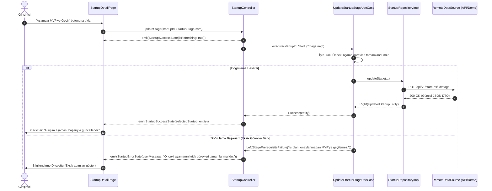
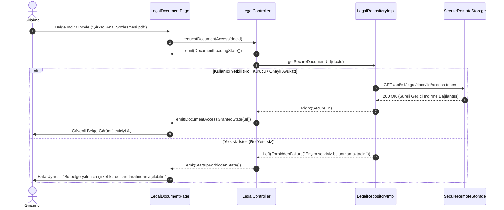

# Girişim360 — Durum Yönetimi ve Veri Akışı Kılavuzu (State Flow & Data Lifecycle Reference)

Bu doküman, Girişim360 Flutter uygulamasındaki durum yönetimi (state management), tek yönlü veri akışı (unidirectional data flow), katman sorumlulukları, hata yönetimi ve güvenlik sınırlarını belirleyen referans kılavuzdur.

Bu kılavuz; `project.md`, `.agents/skills/architecture/SKILL.md` ve `.agents/skills/design/SKILL.md` belgelerinde tanımlanan ilkelerle %100 uyumlu olarak hazırlanmıştır.

---

## 1. Mimari Prensipler ve Veri Akışı Genel Bakışı

Girişim360, **Feature-First (Özellik Öncelikli)**, **Modüler** ve **Katmanlı (Layered / Clean Architecture)** mimari yaklaşımını benimser.

### 1.1. Tek Yönlü Veri Akışı (Unidirectional Data Flow)

Uygulamada veri akışı kesin kurallara bağlıdır ve ters yönde kontrolsüz veri transferine izin verilmez:

```text
┌────────────────────────────────────────────────────────────────────────┐
│                          PRESENTATION KATMANI                          │
│                                                                        │
│   [ Page / View ] ──(Kullanıcı Olayı)──► [ Controller / Notifier ]     │
│          ▲                                         │                   │
│          │                                         │ (İş Mantığı İsteği)│
│          └───(Immutable State / Reaktif Dinleme)───┘                   │
└────────────────────────────────────────────┬───────────────────────────┘
                                             │
                                             ▼
┌────────────────────────────────────────────────────────────────────────┐
│                             DOMAIN KATMANI                             │
│                                                                        │
│   [ Use Case / Interactor ] (Gerektiğinde orkestrasyon & iş kuralı)   │
│                          │                                             │
│                          ▼                                             │
│   [ Repository Sözleşmesi (Abstract Interface) ]                       │
│   [ Entities & Value Objects (Saf Dart Nesneleri) ]                    │
└────────────────────────────────────────────┬───────────────────────────┘
                                             │
                                             ▼
┌────────────────────────────────────────────────────────────────────────┐
│                              DATA KATMANI                              │
│                                                                        │
│   [ Repository Implementation ]                                        │
│          │                                                             │
│          ├──► [ Remote Data Source (REST API / GraphQL / Demo Source) ]│
│          ├──► [ Local Data Source (Secure Storage / SQLite / Cache) ]  │
│          └──► [ DTO (Data Transfer Object) ⇄ Entity Mappers ]          │
└────────────────────────────────────────────────────────────────────────┘
```

### 1.2. Katman Sorumluluk Matrisi

| Katman | Sorumluluk | İzin Verilenler | Kesinlikle Yasak Olanlar |
| :--- | :--- | :--- | :--- |
| **Presentation** | UI çizimi, kullanıcı girdilerini yakalama, animasyonlar, UI durumu | `ThemeData`, `ColorScheme`, Controller dinleme, yerel `setState` (yalnızca geçici UI durumları için) | Doğrudan HTTP istekleri, SQL sorguları, iş kuralları, şifre/token loglama |
| **Domain** | Çekirdek iş kuralları, aşama/ilerleme algoritmaları, varlıklar | Saf Dart sınıfları, soyut arayüzler, use case'ler, domain validasyonları | `package:flutter` widget bağımlılıkları, somut veritabanı/ağ paketleri |
| **Data** | Veri sağlama, önbellekleme, DTO dönüşümleri, hata eşleme | Repository uygulamaları, ağ istemcileri, SQLite/Secure Storage, DTO mappers | UI widget'larına bağımlılık, iş kuralı kararları verme |
| **Core** | Ortak altyapı araçları, tema sistemi, ağ istemcisi, ortak hatalar | Paylaşılan log filtreleri, hata tipleri, theme token'ları, tarih/para formatlayıcılar | Herhangi bir `feature` modülüne özel iş mantığı |

---

## 2. Durum Yaşam Döngüsü ve Modelleme (State Lifecycle)

Girişim360'ta her ekran ve iş akışı, son kullanıcı deneyimini kesintisiz kılmak amacıyla 5 temel durum ve 2 özel durumu açıkça ele almak zorundadır:

### 2.1. Temel Durumlar

1. **Initial (Başlangıç Durumu):** Ekran henüz açıldığında veya sorgu parametreleri beklenirken geçerlidir.
2. **Loading (Yükleniyor Durumu):** Asenkron işlem yürütülürken gösterilen durum. Skeleton veya Material 3 `CircularProgressIndicator` kullanılır.
3. **Success / Data (Başarı Durumu):** Verinin eksiksiz ve doğrulanmış olarak UI'a teslim edildiği durum.
4. **Empty (Boş Veri Durumu):** İstek başarılı olmuş ancak liste veya kayıt boş dönmüştür (örneğin henüz kayıtlı girişim veya mentor yok).
5. **Error (Hata Durumu):** İşlem sırasında hata oluşmuş ve kullanıcıya eyleme dönük, Türkçe hata mesajı gösterilmektedir.

### 2.2. Özel Durumlar

- **Refreshing (Arka Planda Yenileme):** Mevcut veriyi ekranda tutarken yukarıdan çekerek yenileme (`RefreshIndicator`) yapılması.
- **Unauthorized / Forbidden (Yetkisiz Erişim):** Kullanıcının ilgili girişime veya hukuki belgeye erişim yetkisi olmaması durumu (Güvenlik sınırları gereği).

### 2.3. Dart 3 Sealed Class ile Durum Modelleme

Durum sınıfları Dart 3 `sealed class` yapısıyla tasarlanır; bu sayede derleyici tüm durumların UI katmanında eksiksiz ele alındığını (`switch-case` exhaustive matching) garanti eder:

```dart
// lib/features/startup/presentation/controllers/startup_state.dart

import 'package:flutter/foundation.dart';
import '../../domain/entities/startup_entity.dart';

@immutable
sealed class StartupState {
  const StartupState();
}

/// 1. Başlangıç Durumu
final class StartupInitialState extends StartupState {
  const StartupInitialState();
}

/// 2. Yükleniyor Durumu (İlk yükleme veya tam ekran bloklama)
final class StartupLoadingState extends StartupState {
  final String? loadingMessage;
  const StartupLoadingState({this.loadingMessage});
}

/// 3. Başarı / Veri Durumu
final class StartupSuccessState extends StartupState {
  final List<StartupEntity> startups;
  final StartupEntity? selectedStartup;
  final bool isRefreshing;

  const StartupSuccessState({
    required this.startups,
    this.selectedStartup,
    this.isRefreshing = false,
  });

  StartupSuccessState copyWith({
    List<StartupEntity>? startups,
    StartupEntity? selectedStartup,
    bool? isRefreshing,
  }) {
    return StartupSuccessState(
      startups: startups ?? this.startups,
      selectedStartup: selectedStartup ?? this.selectedStartup,
      isRefreshing: isRefreshing ?? this.isRefreshing,
    );
  }
}

/// 4. Boş Veri Durumu (Girişim bulunamadı)
final class StartupEmptyState extends StartupState {
  final String message;
  final String actionLabel;

  const StartupEmptyState({
    this.message = 'Henüz kayıtlı bir girişiminiz bulunmuyor.',
    this.actionLabel = 'İlk Girişimini Oluştur',
  });
}

/// 5. Hata Durumu (Aksiyon alınabilir Türkçe hata)
final class StartupErrorState extends StartupState {
  final String userMessage;
  final String? errorCode;
  final bool canRetry;

  const StartupErrorState({
    required this.userMessage,
    this.errorCode,
    this.canRetry = true,
  });
}

/// 6. Yetkisiz Erişim Durumu (KVKK / Belge Gizliliği Koruması)
final class StartupForbiddenState extends StartupState {
  final String reason;

  const StartupForbiddenState({
    this.reason = 'Bu girişimin verilerini görüntüleme yetkiniz bulunmamaktadır.',
  });
}
```

---

## 3. Girişim360 Modüllerine Özgü Durum Akış Senaryoları

### 3.1. Senaryo A — Girişim Yönetimi, Aşama Geçişi ve İlerleme Hesaplama

Girişim360 projesinde girişim aşamaları 7 adımdan oluşur:
1. `Fikir` (Idea)
2. `Doğrulama` (Validation)
3. `İş Planı` (Business Plan)
4. `MVP / Prototip` (MVP / Prototype)
5. `Şirketleşme` (Incorporation)
6. `Pazara Çıkış` (Go-to-market)
7. `Büyüme` (Growth)

#### İlerleme Hesaplama İş Kuralı (Domain Katmanı):
İlerleme yüzdesi rastgele veya yalnızca görsel amaçlı üretilmez. Tamamlanan kilometre taşları ve zorunlu görevlerin ağırlıklı ortalaması ile hesaplanır:

$$\text{İlerleme } (\%) = \left( \frac{\text{Tamamlanan Görev Sayısı}}{\text{Toplam Görev Sayısı}} \times 0.6 + \frac{\text{Tamamlanan Kilometre Taşı}}{\text{Toplam Kilometre Taşı}} \times 0.4 \right) \times 100$$



---

### 3.2. Senaryo B — Mentor–Menti Eşleşmesi ve Uyum Puanı Akışı

- Mentor uyum puanı sektör, uzmanlık alanı, girişim aşaması ve ihtiyaç kriterlerine göre algoritmik ağırlıklarla (örnek: Sektör %35, Aşama %30, Uzmanlık %35) hesaplanır.
- **Önemli Kural:** Demo eşleşmeler gerçek mentor bağlantısı gibi gösterilmez; kart üzerinde "Demo Veri / Simülasyon" rozeti yer alır.

```text
[ Mentor Listeleme Ekranı ]
         │
         ├──► Controller.loadMatches(startupId)
         │           │
         │           ├──► [Loading State] -> Skeleton Kartlar
         │           ├──► Repository.getRecommendedMentors()
         │           │           │
         │           │           ├──► Başarı -> Uyum Puanına Göre Sıralı Liste (%92, %85...)
         │           │           └──► Boş Veri -> MentorEmptyState ("Kriterlerinize uygun yeni mentor bulunamadı")
         │
         └──► Kullanıcı: "Görüşme Talebi Gönder"
                     │
                     ├──► BottomSheet Form (Tarih, Amaç, Not)
                     ├──► Controller.sendRequest(mentorId, scheduleSlot)
                     └──► Başarılı Geri Bildirim + Talep Durumu: "Beklemede (Pending)"
```

---

### 3.3. Senaryo C — Hukuki Süreçler, Avukat ve Hassas Belge Yönetimi

- Faaliyet alanına göre hukuki adımlar dinamik belirlenir (Örn: E-ticaret için KVKK & Mesafeli Satış Sözleşmesi; Biyoteknoloji için Patent & Ruhsat).
- Avukat doğrulanma durumu rozetle gösterilir.
- **Güvenlik ve KVKK:** Belge listelerinde hassas dosya içerikleri herkese açık önizlenmez. Yalnızca yetkili kullanıcıya süreli indirme bağlantısı (Signed URL / Token) sağlanır. Loglara hiçbir belge içeriği veya kişisel veri yazılmaz.



---

### 3.4. Senaryo D — İş Planı Oluşturma ve Yapay Zekâ Analiz Durumu

- İş planı 9 ana bölümden oluşur: Problem-Çözüm, Ürün, Pazar, Rakipler, Gelir Modeli, Pazarlama, Ekip, Finansal Tahminler, Riskler.
- **Önemli Kural:** Yapay zekâ tarafından üretilen analizler "Tahmin ve İyileştirme Önerisi" olarak etiketlenir, asla doğrulanmış finansal/hukuki gerçeklik gibi sunulmaz.

```text
[ İş Planı Ekranı ]
       │
       ├──► 1. Eksik Bölüm Kontrolü (Form Doğrulama Durumu)
       │         └── Finansal Tablolar Eksikse: Uyarı Etiketi + Tamamlama Butonu
       │
       ├──► 2. "Yapay Zekâ ile Analiz Et" Butonu
       │         ├──► emit(BusinessPlanAnalyzingState(progress: 45%, step: "Finansal riskler taranıyor"))
       │         └──► Sonuç Başarılı:
       │                   ├── Analiz Özeti Kartı
       │                   ├── Eksik Noktalar Listesi
       │                   ├── Risk Değerlendirmesi ("Simülasyon / Öneri" Etiketiyle)
       │                   └── Tutarsız Varsayım Uyarıları
       │
       └──► 3. Finansal Hesaplamalar
                 └── UI dışında saf domain kurallarıyla (Break-even / Başabaş, Nakit Akışı) test edilebilir hesaplanır.
```

---

### 3.5. Senaryo E — Destek ve Teşvik Programları Takibi

- Hibe, KOSGEB, TÜBİTAK, kuluçka ve hızlandırma programları.
- Son başvuru tarihi geçmiş programlar açık kırmızı/gri rozetle işaretlenir; süresi geçen program için başvuru butonu devre dışı bırakılır (`disabled`).
- Verinin son kontrol tarihi ve resmi kaynak bağlantısı gösterilir.

---

## 4. Hata Yönetimi ve Exception-Failure Eşleme Tablosu

Girişim360 uygulamasında teknik istisnalar (Exceptions), data katmanında yakalanarak kullanıcıya dönük anlamlı **Failure** nesnelerine dönüştürülür:

```dart
// lib/core/errors/failures.dart

sealed class Failure {
  final String message;
  final String? code;
  const Failure(this.message, {this.code});
}

class NetworkFailure extends Failure {
  const NetworkFailure([String message = 'İnternet bağlantınızı kontrol edip tekrar deneyiniz.'])
      : super(message, code: 'NET_01');
}

class ServerFailure extends Failure {
  const ServerFailure([String message = 'Sunucu ile iletişim kurulurken bir sorun oluştu. Lütfen daha sonra tekrar deneyiniz.'])
      : super(message, code: 'SRV_500');
}

class AuthFailure extends Failure {
  const AuthFailure([String message = 'Oturum süreniz doldu. Lütfen tekrar giriş yapınız.'])
      : super(message, code: 'AUTH_401');
}

class ForbiddenFailure extends Failure {
  const ForbiddenFailure([String message = 'Bu işlem için yetkiniz bulunmamaktadır.'])
      : super(message, code: 'AUTH_403');
}

class ValidationFailure extends Failure {
  const ValidationFailure(super.message) : super(code: 'VAL_01');
}
```

### Eşleme Matrisi

| Ham Hata / Durum | Yakalanan İstisna | Çıkarılan Failure | Kullanıcı UI Mesajı | UI Eylemi |
| :--- | :--- | :--- | :--- | :--- |
| **Ağ Kesintisi / Timeout** | `SocketException`, `TimeoutException` | `NetworkFailure` | "İnternet bağlantısı kurulamadı." | Tekrar Dene Butonu |
| **401 Unauthorized** | `HttpException(401)` | `AuthFailure` | "Oturum süreniz doldu." | Giriş Ekranına Yönlendir |
| **403 Forbidden** | `HttpException(403)` | `ForbiddenFailure` | "Bu belgeyi görüntüleme yetkiniz yok." | Bilgi İletişim Kutusu |
| **404 Not Found** | `HttpException(404)` | `ServerFailure` | "İlgili girişim veya program bulunamadı." | Geri Dön Butonu |
| **500 Internal Error** | `HttpException(500)` | `ServerFailure` | "Geçici bir sistem hatası oluştu." | Destek Bildirimi Aç |
| **Eksik Form / Aşama Şartı** | `FormatException` | `ValidationFailure` | "Zorunlu alanları doldurunuz." | Alan Altı Hata Metni |

---

## 5. Güvenlik, Gizlilik ve KVKK İlkeleri

1. **İstemci Güvenilmezdir:** Mobil uygulamada buton gizlemek veya rota engellemek bir güvenlik önlemi değildir. Backend her API çağrısında kullanıcı rolünü ve girişim yetkisini zorunlu olarak denetlemelidir.
2. **Loglama Kuralları:**
   - Şifreler, token'lar, API key'ler, kimlik numaraları asla `print()` veya log kütüphanelerine yazılmamalıdır.
   - Hassas hukuki sözleşmelerin içerikleri log dosyalarında yer alamaz.
3. **Demo ve Canlı Veri Ayrımı:**
   - Demo veri kaynakları (`MockStartupDataSource`) açıkça etiketlenmelidir.
   - Gerçek kullanıcı oturumu açıldığında sahte verilerle kullanıcı verisi birbirine karıştırılmamalıdır.
4. **Dosya İndirme & Depolama:**
   - Hukuki belgeler cihazın genel (public) depolama alanına şifresiz ve yetkisiz kaydedilmemeli; uygulama içi güvenli dizinler kullanılmalıdır.

---

## 6. Geliştirici ve Ajan Kontrol Listesi (State Flow Checklist)

Bir özellik veya ekran geliştirirken şu adımları doğrulayın:

- [ ] **5 Durum Ele Alındı mı?** Loading, Success, Empty, Error ve Initial durumları UI'da temsil edildi mi?
- [ ] **İş Mantığı Katmanı Temiz mi?** Widget build metodunda hesaplama, HTTP çağrısı veya iş kuralı var mı? (Olmamalıdır).
- [ ] **Immutable State Kullanıldı mı?** State nesneleri `sealed class` veya `@immutable` ile korunuyor mu?
- [ ] **Türkçe Hata Mesajları:** Teknik hata kodları doğrudan son kullanıcıya gösterilmek yerine eyleme dönük Türkçe açıklamalar yapıldı mı?
- [ ] **Yetkisiz Durum (Forbidden):** Kullanıcının yetkisi olmadığında uygun UI uyarısı veriliyor mu?
- [ ] **Demo Veri Ayrımı:** Eğer özellik henüz gerçek backend'e bağlı değilse, kullanıcıya açıkça demo olduğu gösteriliyor mu?
- [ ] **Tema Uyumu:** Durum widget'ları (`LoadingIndicator`, `EmptyView`, `ErrorView`) Material 3 tema renklerini (`colorScheme.primary`, `colorScheme.error` vb.) kullanıyor mu?
